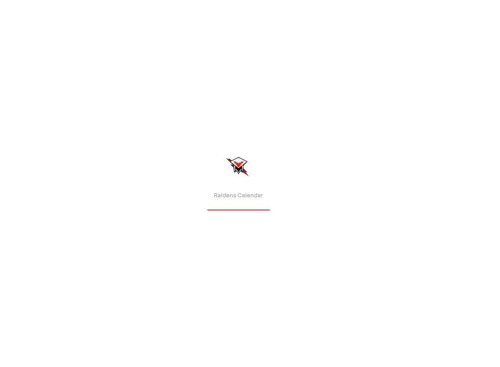
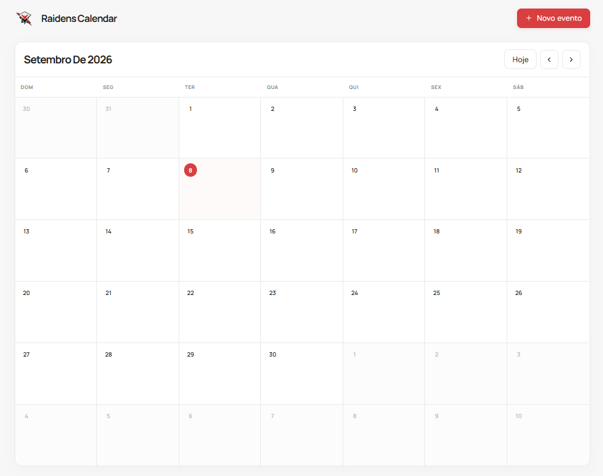
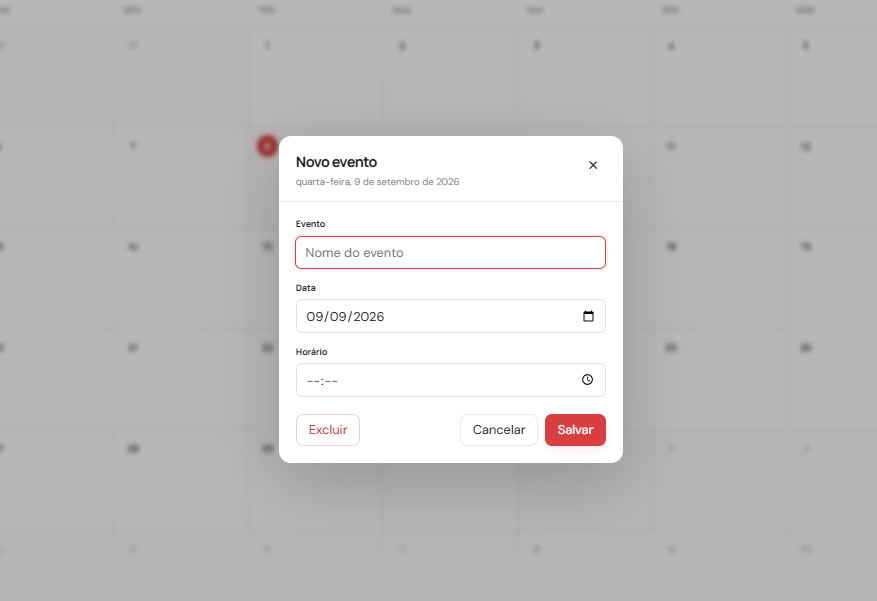

<div align="center">


# Raidens Calendar

**Calendário de eventos da equipe RAIDENS: leve, responsivo e sem dependências**


[Sobre](#sobre) · [Telas](#telas) · [Funcionalidades](#funcionalidades) · [Como usar](#como-usar) · [Estrutura](#estrutura)

</div>

---

## Sobre

O **Raidens Calendar** organiza treinos, reuniões e datas de competição da equipe em uma visão mensal simples. Ele roda inteiro no navegador, em HTML, CSS e JavaScript puros: não precisa de servidor, build nem instalação. Os eventos ficam salvos no `localStorage`, então continuam lá quando você fecha e abre a página.

## Telas

<table>
  <tr>
    <td align="center" width="33%"><b>Pre-loader</b></td>
    <td align="center" width="33%"><b>Visão mensal</b></td>
    <td align="center" width="33%"><b>Novo evento</b></td>
  </tr>
  <tr>
    <td></td>
    <td></td>
    <td></td>
  </tr>
  <tr>
    <td>Logo com animação de pulso e barra de progresso enquanto a página carrega.</td>
    <td>Mês completo, dia atual em destaque e navegação entre meses.</td>
    <td>Nome, data e horário, com validação dos campos e opção de excluir.</td>
  </tr>
</table>

## Funcionalidades

- **Visão mensal** com 42 dias (6 semanas), sem cortes entre meses
- **Navegação** pelas setas na tela, pelo botão **Hoje** ou pelo teclado
- **Criar, editar e excluir eventos** com título, data e horário
- **Salvamento automático** no `localStorage`, com indicador visual
- **Layout responsivo** para computador e celular
- **Animações suaves** na troca de mês, na abertura do diálogo e nas interações

### Atalhos de teclado

| Tecla | Ação |
|---|---|
| <kbd>←</kbd> | Mês anterior |
| <kbd>→</kbd> | Próximo mês |

## Como usar

```bash
git clone https://github.com/sesiraidens/RaidensCalendar.git
```

1. Abra o `index.html` em um navegador moderno.
2. Clique em um dia ou em **+ Novo evento**.
3. Preencha os campos e clique em **Salvar**.

Os eventos ficam no navegador em que foram criados. Para usá-los em outro computador, cadastre-os de novo lá.

### Compatibilidade

Chrome 90+, Firefox 88+, Edge 90+ e Safari 14+.

## Estrutura

```text
RaidensCalendar/
├── index.html      # Página e pre-loader
├── css/            # Estilos, variáveis e animações
├── js/             # storage → calendar → dialog → app
└── assets/         # Capturas de tela
```

O JavaScript é dividido por responsabilidade: `storage.js` cuida do `localStorage`, `calendar.js` desenha o mês e trata a navegação, `dialog.js` controla o formulário e `app.js` inicializa tudo.

---

<div align="center">


**Equipe RAIDENS** · SESI 192 Alumínio/SP

[](mailto:sesiraidens@gmail.com)
[](https://linktr.ee/sesiraidens)
[](https://github.com/sesiraidens)

</div>

